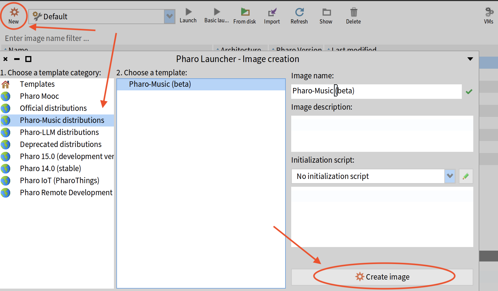

# Accessible Artful Plugin Design with Phausto and JUCE

[Artful Design](https://artful.design/) is a design practice in search of the sublime, where form follows function and aesthetics is coupled with ethics. It is design that is expressive, socially meaningful, and humanistic. But designing audio plugins usually means fighting with C++ before you ever hear a sound. This workshop flips that order. Using [Phausto](https://github.com/lucretiomsp/phausto), a DSP DSL inside the live [Pharo](https://pharo.org/) environment, you will prototype an artful multieffect, with no C++ for the audio engine. Phausto's [JUCE](https://juce.com/) exporter then hands you a complete project: Projucer and CMake files, the processor and editor definitions and implementations, and the glue code that ties them together. The only C++ you write is the UI, which you will sketch quickly in Bloc and p5.js and translate into JUCE components with help from an LLM. By the end you will have built, assembled, and tested a working plugin in your own DAW, and seen how an accessible workflow leaves more room for design that has character. And you will have learnt how to design sound, graphics, and interaction together for play and delight.

## Resources

Download the workshop slides in PDF [here](/resources/AccesiblePluginDesignWithPhaustoAndJUCE.pdf)

[Pharo MOOC](https://mooc.pharo.org/)

[Sletz's FAUST step-by-step tutorial](https://sletz.github.io/faust-tutorial/index.html)

[Pharo by Example 9](https://books.pharo.org/pharo-by-example9/)

[Professor Ge Wang on Artful Design](https://www.youtube.com/watch?v=413qyNDmBxg)

## Download the Pharo Music Image
The **Pharo Music** image is a ready-made Pharo image with Phausto and its native
libraries already in place. To install it, first download the [Pharo Launcher](https://pharo.org/download), then:

1. Click **New** → select category **Pharo-Music distributions**
2. Choose **Pharo Music (demo)** from the template list
3. Click **Create image**
4. Double-click the new image to launch it



## Start Your Engine
```smalltalk
"Lets hear the effect chain on a loop player"
path := TurboPhausto turboSamplesFolder , '/breaks'  .
loop := PhLoopSpeedLevel new pathToFolder: path.

chain :=( GreyHole new mergeWith: PhTranspose  new) => PhBitCrusher  new.

dsp := (DryWetMonoMixer new fx: chain; input: loop) stereo asDsp.

dsp := (loop => GreyHole new) stereo asDsp.
dsp init.
dsp start.
dsp displayUI.

"when you are done"
dsp stop; destroy.

"lets rewrite the effect but  without sending the input: message so by default it uses external inputs"
chain :=( GreyHole new mergeWith: PhTranspose  new) => PhBitCrusher  new.
dsp := (DryWetMonoMixer new fx: chain) stereo asDsp.

dsp init.
"now we export it with a generic editor"
dsp export2JuceWithName: 'TempestaGeneric' type: PhEffectPluginType new.
```

To build your plugin, you need Cmake. You can check if it is installed on your system by executing
```bash
cmake --version
```
If you need to install it, follow [these instructions](https://github.com/lucretiomsp/ADC26Workshop/wiki/Installing-CMake)

now open a terminal, get inside the folder created by the exporter and execute:
```bash
cmake -P build.cmake
```

